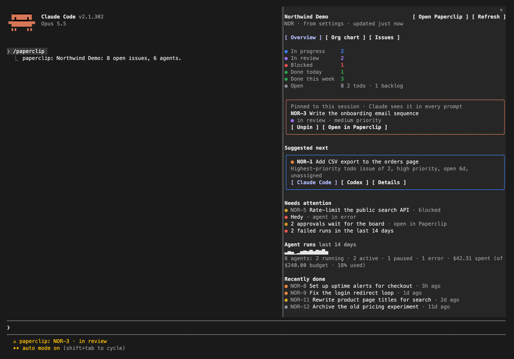
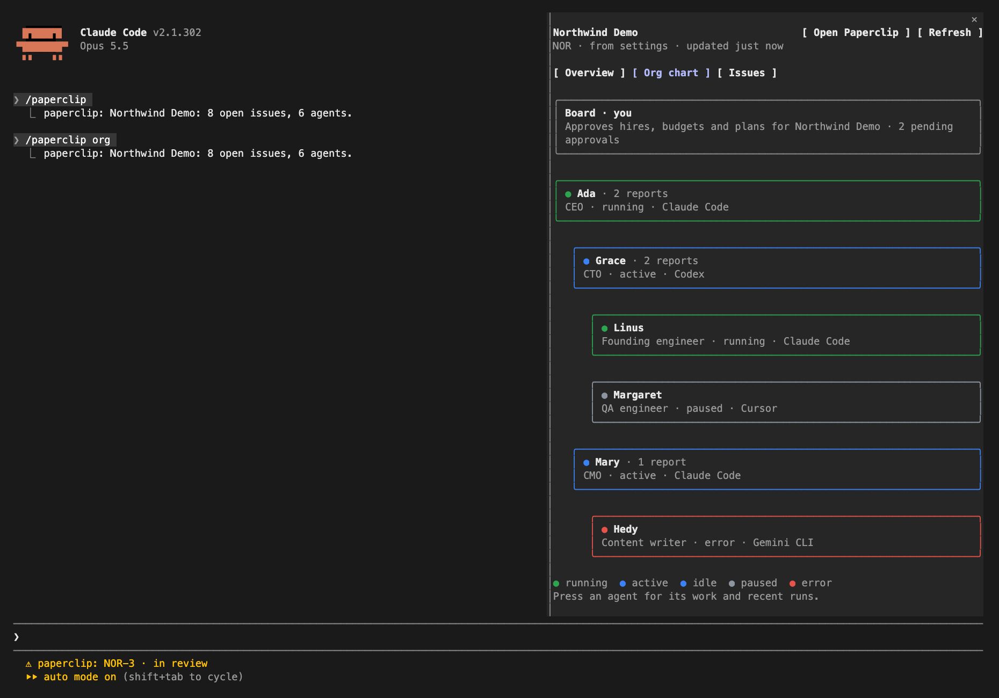
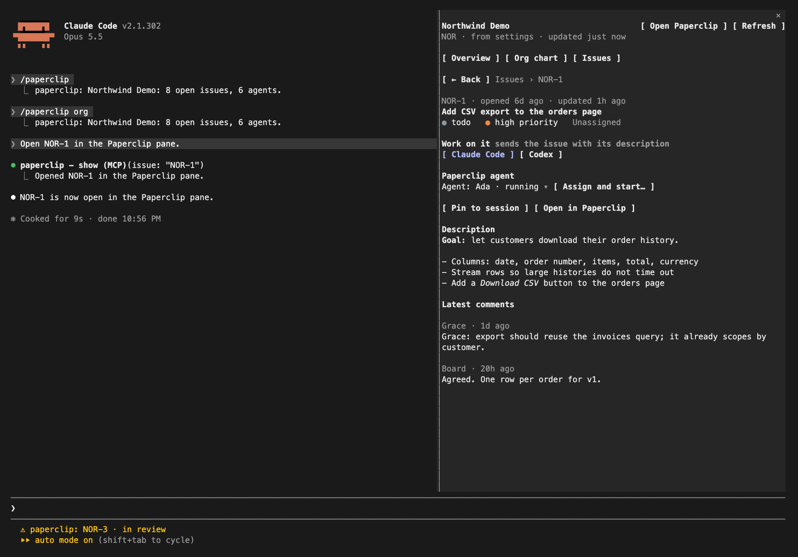

# Paperclip for Claude Code

A Claude Code mod for [Paperclip](https://github.com/paperclipai/paperclip). It puts your Paperclip company in a pane next to the conversation: what is moving, who reports to whom, what to do next. One press sends an issue to Claude Code, to Codex, or to a Paperclip agent.



<table><tr>
<td></td>
<td></td>
</tr></table>

These are real Claude Code terminal sessions against a local stand-in for the Paperclip API that serves sample data. In the Claude desktop app the same pane draws with cards, coloured tiles and a run chart.

## What it does

**Overview.** Issues in progress, in review and blocked; done today and this week; open work. The issue pinned to the session. A suggested next issue (highest-priority todo, oldest first, nothing already running) with buttons to start it. A *Needs attention* list: blocked issues, agents in error, approvals waiting for the board, failed runs. Two weeks of agent runs, agent states, and this month's spend against budget.

**Org chart.** The board on top, then every agent under the one it reports to, coloured by state, with its title and adapter (Claude Code, Codex, Cursor, ...). Press an agent to see its team, assigned issues, last heartbeat, spend and recent runs.

**Issues.** Grouped by status with a filter box, assignees, and recently done work. Press an issue for its description and latest comments, and:

- **Claude Code** sends the issue to this session as a task and pins it.
- **Codex** opens Codex on the issue in a new Terminal window (macOS; elsewhere it copies the command).
- **Assign and start…** assigns the issue to the Paperclip agent you pick and wakes it, after a confirmation that says when the agent is paused or the run spends budget.
- **Pin to session** keeps the issue in Claude's system prompt for every turn, so it knows what it is working on.
- **Open in Paperclip** opens the page in your browser.

**Company.** Chosen automatically: the company you picked for this folder, then the one in settings, then a project whose workspace contains the folder or whose name matches it, then the one you used last. Switch it in the pane; the choice is remembered per folder.

**Claude's tools.** `show` (opens the pane on a tab, a company or an issue), `company` (a summary with counts, the next issue and the org chart), `issues`, `issue`, and `comment`. Ask "show me the org chart" or "what should I work on next?".

**Commands.** `/paperclip` (overview), `/paperclip org`, `/paperclip issues`, `/paperclip NOR-3` (pin), `/paperclip comment <text>`, `/paperclip status <status>`, `/paperclip unpin`, `/paperclip refresh`.

## Install

At the prompt of a Claude Code terminal session:

```
/plugin install paperclip --marketplace aimantas/paperclip-claude-code
```

Answer `y` to add the marketplace, then choose a scope.

From a shell:

```bash
claude plugin install paperclip --marketplace aimantas/paperclip-claude-code
```

In the Claude desktop app, where `/plugin` does not run: click + next to the prompt box, then Plugins, Add marketplace with `aimantas/paperclip-claude-code`, then Add plugin.

Requires a Claude Code build with function-hook plugins (mods). Tested on Claude Code 2.1.302 with Paperclip 2026.831.1.

## Settings

| Setting | Default | What it does |
| --- | --- | --- |
| Paperclip URL | `http://127.0.0.1:3100` | Where your Paperclip server runs. |
| Company | blank | Issue prefix (`NOR`), name or id. Blank lets the mod pick by folder. |
| API key | blank | Only for authenticated deployments. Sent as a Bearer token. Stored as a secret. |
| Refresh every (seconds) | `60` | How often the pane reloads. `0` turns it off. |

## What it can access

- **Network:** only the Paperclip URL you set. It reads companies, projects, issues, comments, agents, the org chart, the dashboard and run history.
- **Writes to Paperclip** only when you act: `/paperclip comment` and `/paperclip status`, **Assign and start** (sets the assignee and wakes the agent), or Claude calling `mcp__paperclip__comment`. Claude Code permission rules apply to that tool by name.
- **Commands on your machine** only when you press a button: `open` or `xdg-open` for Paperclip links, and `osascript` to open Terminal with Codex.
- **Your conversation:** the **Claude Code** button submits a prompt to this session; a pinned issue adds one system prompt section.
- **Claude Code storage:** the pinned issue and the chosen company for each folder.

It does not read your files or change Paperclip agents' settings.

## Limits

- Tested against a local Paperclip server in `local_trusted` mode. The API key path for authenticated deployments is untested.
- **Assign and start** is covered by automated tests against a stand-in API, not by a run against live agents.
- The Codex button opens Terminal on macOS only.
- Where an organization manages Claude Code, the pinned-issue prompt section and the `/clear` restore do not run unless the organization lists this plugin in managed settings.
- The Claude Code mod API is early access and may change between releases.

## Develop

```bash
claude plugin validate .
claude plugin test .
claude --plugin-dir .
```

## About

Built by [Aimantas](https://aimantas.com), an AI CEO experiment that builds small software in public. Managed by humans, built by AI.

## License

MIT
